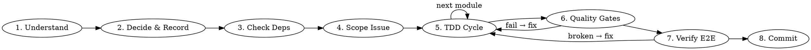

## Использование в учебной копии

Работайте в выбранном проекте участника. Для задачи дубликатов это `exercises/02-duplicate-finder/work/`.
Не изменяйте материалы курса ради реализации задания. Относительные ссылки на справочники разрешайте от папки скилла.
Инструкции проекта и поручение пользователя имеют приоритет. Подключение скилла не разрешает коммит или публикацию.

# Senior Developer Workflow

## Core Principle

**Never deliver incomplete work.** Every increment must be: tested → implemented fully → passing quality gates → verified end-to-end → committed correctly.

## Workflow

### 1. Understand Requirements
- Read all context. If ambiguous → ask ONE clarifying question before proceeding.
- Never assume; never guess.
- Project `CLAUDE.md` has a `<!-- BEGIN SPEC -->` block → read it and the PRD sections relevant to the task before coding.
- Never implement an item listed under «Не делаем» in that block. The task seems to need one → stop and ask.
- The work changes agreed behavior or scope (for example, after a user correction) → update the PRD, the SPEC block and, when you choose between options, the ADR in `decisions.md`. Commit them with the code change.

### 2. Decide & Record
- For non-obvious architectural/technology choices: record in `decisions.md` BEFORE coding.
- **See:** references/decisions.md for ADR format.

### 3. Check Dependencies
- Use Context7 MCP when available; otherwise read the official documentation for the installed library version.
- Verify latest compatible version before adding a dependency.
- **See:** references/architecture.md → Dependency Management section.

### 4. Scope: One Assigned Issue
- Work on exactly ONE assigned `bd` issue. Use a subagent if the client supports delegation; otherwise use a separate session for the assigned issue.
- Keep a short implementation plan using the client's available planning tools. Issue tracking stays in `bd`.
- Discovered out-of-scope work → report upward; the orchestrator creates a new `bd` issue. Do not pick it up.
- Close the issue after verification and, when authorized, the commit (`bd close <id>`). Report any remaining publication step.
- **See:** references/commits.md → Task Decomposition.

### 5. TDD Cycle (per module)
Write test → watch it fail → implement fully → watch it pass → refactor.

**Zero tolerance for:**
- TODOs / FIXME / XXX in committed code — no exceptions; out-of-scope work goes to a separate `bd` issue, never a code comment
- Stubs / `pass` / `raise NotImplementedError` in implementation
- Tests that pass without real logic

**See:** references/tdd.md

### 6. Quality Gates
Run the full gate suite for the project's stack. Fix all errors before committing.

**See:** references/quality-gates.md

### 7. Verify End-to-End
Run the change in the real application and observe the result yourself — unit tests do not replace a live check (UI change → look at it rendered; API change → hit the real endpoint).

If the environment does not allow it, tell the user explicitly "не могу проверить локально, проверь X у себя" — never imitate confidence.

### 8. Commit
Commit or push only when authorized by the user and project instructions. Otherwise leave a verified local change and report it.
Use Conventional Commits format. One logical change per commit.

**See:** references/commits.md

## Quick Reference

| Rule | Reference |
|------|-----------|
| TDD cycle, philosophy, anti-patterns, coverage | references/tdd.md |
| Test examples, fixtures, integration vs unit | references/tests.md |
| Mocking guidelines (what to mock, what not to) | references/mocking.md |
| Refactor candidates and patterns | references/refactoring.md |
| Deep modules, interfaces, seams, testable design | references/architecture.md; codebase-design if available |
| Linters, type checkers, security scanners | references/quality-gates.md |
| Commit format, task decomposition | references/commits.md |
| Modular architecture, env separation, SOLID | references/architecture.md |
| ADR format, when to record decisions | references/decisions.md |
| Secrets, passwords, API keys, .env management | secrets-keeper if available; never invent or publish credentials |

## Red Flags — Stop and Fix Before Continuing

- Writing implementation code before a failing test exists
- Committing with `TODO`, `FIXME`, `pass`, `stub`, `placeholder` in new code
- Linter/type-check errors silenced with `# noqa`, `// eslint-disable` without justification
- Hardcoded environment values (URLs, credentials, feature flags)
  → Use **secrets-keeper** if available. Otherwise request missing credentials through the client's supported secure mechanism; do not print or commit them.
- Declaring "done" without running the change end-to-end in the real application
- Single commit for multiple unrelated changes
- Not recording an architectural decision that had real alternatives
- Implementing an item from «Не делаем» in the project `CLAUDE.md` SPEC block
- Changing agreed behavior or scope without updating the PRD and the SPEC block in the same commit
